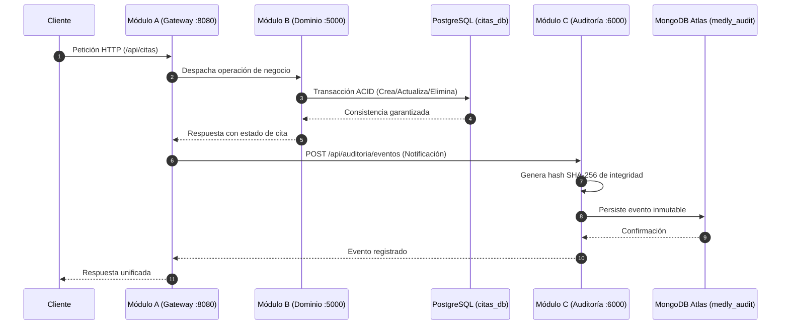

# Medly — Plataforma de Gestión de Consultas Médicas

Arquitectura de microservicios heterogénea compuesta por 3 módulos principales y 2 motores de bases de datos:

| Módulo | Rol | Tecnología | Puerto |
|--------|-----|-----------|--------|
| **A** — API Gateway | Ingesta y orquestación de llamadas | Node.js + Express | `8080` |
| **B** — Servicio de Dominio | Lógica de negocio y transacciones de citas | Python + FastAPI | `5000` |
| **C** — Trazabilidad y Auditoría | Registro inmutable de eventos y trazabilidad | Java 17 + Spring Boot 3 | `6000` |
| **DB Relacional** | Persistencia ACID de citas médicas | PostgreSQL 16 | `5432` |
| **DB NoSQL (Atlas)** | Almacén inmutable de auditoría | MongoDB Atlas Local (Docker) | `27017` |

---

## Flujo de Interacción entre Módulos



---

## Requisitos

- [Docker Desktop](https://www.docker.com/products/docker-desktop/) (o Docker Engine + Compose) en ejecución.

---

## Levantar el Proyecto

### Todo el ecosistema (Módulos A, B, C, PostgreSQL y MongoDB Atlas):

```bash
docker compose up --build
```

Para correr en segundo plano (detached mode):

```bash
docker compose up --build -d
```

Para detener todos los servicios:

```bash
docker compose down
```

> **Persistencia**: Los datos se guardan en los volúmenes `pgdata` (PostgreSQL) y `atlas_local_data` (MongoDB). Para limpiar los datos y reiniciar desde cero:
> ```bash
> docker compose down -v
> ```

### Prueba automática de contenedores

Para levantar el stack, esperar a que todos los servicios estén saludables y probar el flujo crear → actualizar → eliminar:

```bash
./test-containers.sh
```

El script deja los contenedores ejecutándose para poder inspeccionarlos. Para detenerlos automáticamente al finalizar:

```bash
./test-containers.sh --down
```

---

## Verificar que los Servicios Están Activos

| Servicio | URL de Verificación | Respuesta esperada |
|----------|----------------------|--------------------|
| **Módulo B (FastAPI)** | `GET http://localhost:5000/health` | `{"status": "UP"}` |
| **Módulo C (Spring Boot)** | `GET http://localhost:6000/api/auditoria/eventos` | `{"status": "SUCCESS", "codigo": 200, ...}` |

---

## Endpoints Disponibles

### A. Operaciones de Citas (Expuestas por el Gateway en el puerto 8080)

Cada una de estas operaciones actualiza el Módulo B y **notifica automáticamente al Módulo C** para auditar el cambio.

#### 1. Crear Cita Médica
```http
POST http://localhost:8080/api/citas
Content-Type: application/json

{
  "paciente_id": "PAC-4412",
  "medico_id":   "MED-008",
  "fecha_hora":  "2026-10-25T10:30:00Z",
  "motivo":      "Control general de salud"
}
```
*Respuesta Exitosa (HTTP 201 Created)*: Genera `cita_id` en estado `PENDIENTE` y crea el evento de auditoría `CREACION` en MongoDB.

#### 2. Cambiar Estado de una Cita
```http
PATCH http://localhost:8080/api/citas/{cita_id}/estado
Content-Type: application/json

{
  "nuevo_estado": "CONFIRMADA",
  "observacion":  "Paciente confirmó por teléfono"
}
```
Estados válidos: `PENDIENTE` · `CONFIRMADA` · `EN_CURSO` · `COMPLETADA` · `CANCELADA`.  
*Respuesta Exitosa (HTTP 200 OK)*: Registra el evento `ACTUALIZACION_ESTADO` con el estado previo y nuevo en Módulo C.

#### 3. Eliminar una Cita
```http
DELETE http://localhost:8080/api/citas/{cita_id}
```
> Regla de negocio: No se puede eliminar una cita en estado `COMPLETADA` o `EN_CURSO` (retorna HTTP 409).  
*Respuesta Exitosa (HTTP 200 OK)*: Registra el evento `ELIMINACION` con estado `ELIMINADA` en Módulo C.

---

### B. Consultas de Auditoría y Trazabilidad (Módulo C en puerto 6000)

| Método | Endpoint | Descripción |
|--------|----------|-------------|
| `GET` | `/api/auditoria/eventos` | Lista todos los eventos de auditoría registrados |
| `GET` | `/api/auditoria/eventos/cita/{citaId}` | Traza completa e histórica de una cita específica |
| `GET` | `/api/auditoria/eventos/tipo/{tipoOperacion}` | Filtra eventos por tipo (`CREACION`, `ACTUALIZACION_ESTADO`, `ELIMINACION`) |
| `GET` | `/api/auditoria/eventos/rango?desde={iso}&hasta={iso}` | Filtra eventos por rango de fechas |
| `POST`| `/api/auditoria/eventos` | Endpoint interno invocado por el Gateway para registrar trazas |

---

## Consultar las Bases de Datos

### 1. PostgreSQL (Citas en Módulo B)
```bash
docker exec -it medly-db-relacional psql -U postgres -d citas_db -c \
  "SELECT cita_id, paciente_id, estado, creado_en FROM citas ORDER BY creado_en DESC;"
```

### 2. MongoDB Atlas Local (Auditoría en Módulo C)
- **Vía línea de comandos (mongosh en Docker)**:
  ```bash
  docker exec -it medly-atlas-local mongosh "mongodb://localhost:27017/medly_audit?directConnection=true" --eval \
    "db.eventos_auditoria.find().sort({timestamp: -1}).pretty()"
  ```
- **Vía MongoDB Compass / Clientes GUI**:
  ```
  mongodb://localhost:27017/medly_audit?directConnection=true
  ```

---

## Base de Datos Versionada en GitHub (`modulo-c/database`)

Para garantizar que el repositorio en GitHub cuente con la base de datos preconfigurada sin almacenar binarios pesados:

- **Script de Inicialización y Semilla**: [`modulo-c/database/init/01-init-audit.js`](modulo-c/database/init/01-init-audit.js).
- Al inicializar el contenedor de Atlas Local, se ejecuta automáticamente creando la base de datos `medly_audit`, la colección `eventos_auditoria`, índices optimizados y datos semilla históricos.
- **Despliegue independiente de la BD**:
  ```bash
  docker compose up -d atlas-local
  ```

---

## Pruebas del Módulo C

El Módulo C incluye varias herramientas de prueba:

1. **Script de pruebas automatizado (Bash + cURL)**:
   ```bash
   ./modulo-c/test-api.sh
   ```
   Ejecuta pruebas secuenciales de creación, cambio de estado, eliminación, consulta de trazas y validación de errores con códigos de salida en color.

2. **Pruebas unitarias y de integración (Java / Maven)**:
   ```bash
   cd modulo-c
   mvn test
   ```
   Incluye `AuditoriaControllerTest.java` (MockMvc) y `AuditoriaServiceTest.java` (JUnit 5 + Mockito).

3. **Suite HTTP para IDEs**:
   - Archivo [`modulo-c/tests.http`](modulo-c/tests.http) ejecutable directamente desde VS Code (REST Client) o IntelliJ IDEA.

---

## Estructura del Proyecto

```
medly/
├── docker-compose.yml              ← Orquestación de todos los contenedores y redes
├── README.md                       ← Documentación general del sistema
│
├── modulo-a/                       ← API Gateway (Node.js + Express | Puerto 8080)
│   ├── index.js
│   └── Dockerfile
│
├── modulo-b/                       ← Servicio de Dominio (FastAPI + Python | Puerto 5000)
│   ├── app.py
│   ├── requirements.txt
│   └── Dockerfile
│
└── modulo-c/                       ← Servicio de Trazabilidad y Auditoría (Spring Boot | Puerto 6000)
    ├── database/                   ← Infraestructura aislada de MongoDB Atlas Local
    │   ├── README.md               ← Guía de conexión a la BD
    │   └── init/
    │       └── 01-init-audit.js    ← Script semilla versionado en GitHub
    ├── src/
    │   ├── main/java/com/medly/moduloc/
    │   │   ├── config/             ← MongoConfig y WebConfig (CORS)
    │   │   ├── controller/         ← AuditoriaController (Endpoints REST)
    │   │   ├── dto/                ← Modelos de petición, respuesta y errores
    │   │   ├── exception/          ← GlobalExceptionHandler
    │   │   ├── model/              ← Documento MongoDB EventoAuditoria
    │   │   ├── repository/         ← EventoAuditoriaRepository
    │   │   └── service/            ← AuditoriaService (SHA-256 e integridad)
    │   └── test/java/com/medly/moduloc/ ← Pruebas unitarias y de integración
    ├── test-api.sh                 ← Script de pruebas automatizadas HTTP
    ├── tests.http                  ← Suite de pruebas para REST Client
    ├── Dockerfile                  ← Compilación multi-stage de Spring Boot
    └── pom.xml                     ← Dependencias Maven
```
